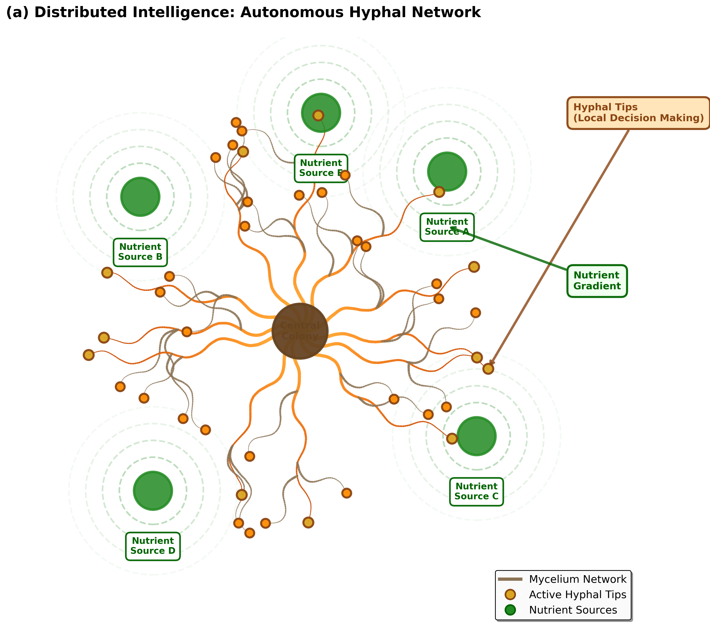

<p align="center">
  
</p>

# Mycelium Network Optimization (MNO) Toolbox

A MATLAB toolbox for **Mycelium Network Optimization (MNO)**, a nature-inspired
metaheuristic modeled on fungal mycelium network dynamics.

MNO combines four mechanisms: fitness-weighted pathway reinforcement,
distributed hyphal growth, golden-ratio logarithmic spiral expansion, and
hierarchical multi-scale search.

**Paper:** N. Praneeth, B. Gnaneswari, S. T. P. Srinivas, P. Dwivedi, O. Dubey,
"A novel nature-inspired optimization paradigm modeled on mycelium network
dynamics", *Neural Computing and Applications* 38, 896 (2026).
https://link.springer.com/article/10.1007/s00521-026-12629-4

---

## Features

- Easy-to-use class-based API: `MNO('PopSize', ..., 'MaxIter', ...)`
- Graphical interface (`MNO_GUI`) for running the optimizer without code
- Library of 10 classic benchmark functions with known global minima
- Convergence plotting and multi-run statistical analysis
- Four worked examples, plus a test suite
- No additional toolboxes required

## Requirements

- MATLAB, tested on **R2021b** (expected to work on later releases)

## Installation

**Option A: toolbox installer (recommended)**

1. Download `MNO_Toolbox.mltbx` from the [Releases](../../releases) page.
2. Double-click the file in MATLAB, or use *Home > Add-Ons > Install from file*.

**Option B: from source**

```matlab
% Download or clone this repository, then in MATLAB:
cd('path/to/Mycellium-Network-Optimizer')
addpath(genpath(pwd));
savepath;
```

**Check the installation**

```matlab
test_toolbox
% Expected: ALL TESTS PASSED SUCCESSFULLY!
```

## Quick start

```matlab
% Define the problem
objFunc = @(x) sum(x.^2);   % Sphere function
dim = 30;                   % number of dimensions
lb  = -100;                 % lower bound
ub  = 100;                  % upper bound

% Create the optimizer
optimizer = MNO('PopSize', 30, 'MaxIter', 100);

% Run
[bestSolution, bestFitness, convergence] = ...
    optimizer.optimize(objFunc, dim, lb, ub);

fprintf('Best fitness: %.6e\n', bestFitness);

% Plot convergence
optimizer.plotConvergence('logScale', true);
```

### Graphical interface

```matlab
MNO_GUI
```

### Using a benchmark function

```matlab
[f, lb, ub, dim, fmin] = BenchmarkFunctions.rastrigin();

optimizer = MNO();
[sol, fit, ~] = optimizer.optimize(f, dim, lb, ub);

fprintf('Error: %.6e\n', abs(fit - fmin));
```

### Multiple runs (statistics)

```matlab
results = zeros(30, 1);
for i = 1:30
    opt = MNO();
    [~, results(i), ~] = opt.optimize(objFunc, dim, lb, ub);
end
fprintf('Mean: %.6e   Std: %.6e\n', mean(results), std(results));
```

## Included files

| File | Purpose |
|---|---|
| `MNO.m` | Main optimizer class |
| `BenchmarkFunctions.m` | 10 benchmark functions |
| `MNO_GUI.m`, `MNO_DialogInterface.m` | Graphical interface |
| `example1_basic_usage.m` | Basic tutorial |
| `example2_benchmark_functions.m` | Using the benchmark library |
| `example3_parameter_tuning.m` | Population size / iteration study |
| `example4_multi_function_comparison.m` | Multi-function testing |
| `test_toolbox.m` | Test suite |

## Benchmark functions

Sphere, Rastrigin, Rosenbrock, Ackley, Griewank, Schwefel, Levy, Zakharov,
Dixon-Price, Michalewicz.

> The paper's results use the CEC 2005, CEC 2017 and CEC 2020 suites and six
> engineering design problems. This toolbox ships the 10 classic functions above
> for quick testing and teaching.

## Troubleshooting

**"Undefined function MNO"**: add the toolbox to the path:

```matlab
addpath(genpath('path/to/Mycellium-Network-Optimizer'));
savepath;
```

**Tests fail**: check your release with `ver('MATLAB')` and open an issue with
the error message.

## Citation

If you use this toolbox, please cite the paper:

```bibtex
@article{praneeth2026mno,
  title   = {A novel nature-inspired optimization paradigm modeled on mycelium network dynamics},
  author  = {Praneeth, N. and Gnaneswari, Bodana and Srinivas, S. T. P. and Dwivedi, Palak and Dubey, Ojashwini},
  journal = {Neural Computing and Applications},
  volume  = {38},
  number  = {22},
  pages   = {896},
  year    = {2026},
  doi     = {10.1007/s00521-026-12629-4}
}
```

## License

MIT License. See [LICENSE](LICENSE).

## Contact

N. Praneeth: <YOUR-EMAIL>
Issues and suggestions are welcome via GitHub Issues.
